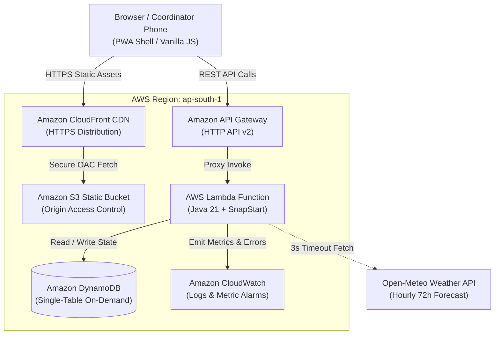

# HeatShield — Community Heatwave Risk-to-Action Planner

[](https://docs.aws.amazon.com/corretto/)
[](https://aws.amazon.com/serverless/)
[](LICENSE)

HeatShield converts ambient weather forecasts and community context into transparent, rule-backed heat risk assessments, prioritised emergency protective actions, and verifiable action completion tracking.

---

## Architecture Diagram



---

## Core Principles & Transparency

1. **Mathematically Rigorous Heat Index**: Implements the official National Oceanic and Atmospheric Administration (NOAA) / National Weather Service (NWS) Rothfusz 9-term polynomial regression with Steadman baseline pre-check, low-RH, and high-RH adjustments.
2. **Dual-Signal Protection**: Evaluates both NWS apparent temperature tiers and official India Meteorological Department (IMD) maximum temperature criteria for plains stations ($\ge 40.0^\circ\text{C}$ gate, $\ge 45.0^\circ\text{C}$ Heat Wave, $\ge 47.0^\circ\text{C}$ Severe Heat Wave).
3. **Data-Driven Playbook**: Action checklists are grounded in the National Disaster Management Authority (NDMA) 2019 Guidelines and the Ahmedabad Municipal Corporation Heat Action Plan (HAP).
4. **Zero PII**: No personal names, phone numbers, or health records are stored. All records pertain to aggregated community wards.

> **Operational Disclaimer**: HeatShield provides environmental planning and operational risk indicators. It is not an individual medical diagnostic tool or personal health advisory. Always adhere to official bulletins from the India Meteorological Department and local disaster management authorities.

---

## Technology Stack & Measured Metrics

- **Runtime**: Amazon Corretto / Java 21 (`release 21`).
- **Framework**: Zero DI framework (pure POJO architecture).
- **Packaging**: Uber-jar produced via `maven-shade-plugin` (measured size: **10.0 MB**).
- **Testing**: 44 automated tests passing (26 golden tests vs NWS charts, IMD evaluation tests, playbook slice tests, and API contract tests).
- **Infrastructure as Code**: AWS SAM (`template.yaml`).
- **AWS Services**: AWS Lambda (SnapStart enabled), Amazon API Gateway HTTP API, Amazon DynamoDB On-Demand (TTL enabled), Amazon S3 + CloudFront (HTTPS), Amazon CloudWatch.

---

## Local Verification Commands

```bash
# 1. Run all automated tests (Golden tests, domain, and API handlers)
mvn clean test

# 2. Package shaded JAR
mvn package

# 3. Validate SAM infrastructure template
sam validate --lint

# 4. Run SAM local API emulator
sam local start-api
```

---

## Mandatory AI Tool Disclosure
This project was designed, implemented, and verified using Google Antigravity as an interactive pair-programming technical mentor and execution coach.
