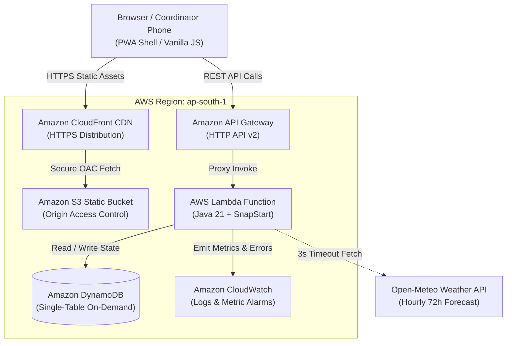

# HeatShield — Community Heatwave Risk-to-Action Planner

[](https://docs.aws.amazon.com/corretto/)
[](https://aws.amazon.com/serverless/)
[](LICENSE)

- **Live Production URL**: [https://d2ijd5tuo68h8.cloudfront.net](https://d2ijd5tuo68h8.cloudfront.net)
- **3-Minute Demo Video**: `[DEMO VIDEO LINK PLACEHOLDER — to be recorded and added upon final submission]`
- **Hackathon Track**: Bharat Builds Tour 2026 / Environmental Hacks (Solo Developer: Manohar Kunda)

HeatShield converts ambient weather forecasts and community context into transparent, rule-backed heat risk assessments, prioritised emergency protective actions, and verifiable action completion tracking.

---

## Where AWS Fits in the Solution Architecture

HeatShield uses an entirely serverless, resilient AWS architecture in `ap-south-1` (Mumbai):
1. **Amazon CloudFront**: Provides a single-origin entrypoint for Indian municipal coordinators. Delivers static PWA assets from edge POPs and routes `/api/*` requests directly to backend services, avoiding cross-origin overhead and enforcing strict Content Security Policies.
2. **Amazon S3**: Hosts static frontend assets securely with Origin Access Control (OAC), completely private with public block policies enabled.
3. **Amazon API Gateway (HTTP API v2)**: Low-latency, cost-effective REST gateway configured with burst and rate throttling to protect downstream compute.
4. **AWS Lambda (Java 21 + SnapStart)**: Executes the Rothfusz regression and IMD dual-signal algorithm with sub-20ms warm invocation latency and fast snapshot restore.
5. **Amazon DynamoDB**: Single-table On-Demand database storing assessments and coordinator field notes, with multi-tenant workspace isolation and automated 7-day TTL expiration to avoid storage accumulation.
6. **Amazon CloudWatch & AWS Budgets**: Monitors Lambda error rates and enforces cost containment alerts ($5.00 threshold) with SNS email notifications.

---

## Architecture Diagram



---

## Core Principles & Transparency

1. **Mathematically Rigorous Heat Index**: Implements the official National Oceanic and Atmospheric Administration (NOAA) / National Weather Service (NWS) Rothfusz 9-term polynomial regression with Steadman baseline pre-check, low-RH, and high-RH adjustments.
2. **Dual-Signal Protection**: Evaluates both NWS apparent temperature tiers and official India Meteorological Department (IMD) maximum temperature criteria for plains stations ($\ge 40.0^\circ\text{C}$ gate, $\ge 45.0^\circ\text{C}$ Heat Wave, $\ge 47.0^\circ\text{C}$ Severe Heat Wave).
3. **Data-Driven Playbook**: Action checklists are grounded in the National Disaster Management Authority (NDMA) 2019 Guidelines and the Ahmedabad Municipal Corporation Heat Action Plan (HAP).
4. **Zero PII**: No personal names, phone numbers, or health records are stored. All records pertain to aggregated community wards.

> **Operational Disclaimer**: HeatShield is a DRAFT planning aid for coordinator review. It is not an official notice, not an IMD warning, not an individual medical diagnostic tool, and not personal health advice. Always adhere to official bulletins from the India Meteorological Department and local disaster management authorities. National emergency: **112**.
>
> **Accessibility**: The frontend is built mobile-first targeting WCAG 2.1 AA; detailed checklist and Lighthouse audit findings are documented in [`docs/ACCESSIBILITY.md`](docs/ACCESSIBILITY.md).

---

## Technology Stack & Measured Metrics

- **Runtime**: Amazon Corretto / Java 21 (`release 21`).
- **Framework**: Zero DI framework (pure POJO architecture).
- **Packaging**: Uber-jar produced via `maven-shade-plugin` (measured size: **10.0 MB**).
- **Testing**: 68 automated tests passing (26 golden tests vs NWS charts, IMD evaluation tests, playbook slice tests, forecast parsing tests, and API contract & hardened privacy filter tests).
- **Infrastructure as Code**: AWS SAM (`template.yaml`).
- **AWS Services**: AWS Lambda (SnapStart enabled), Amazon API Gateway HTTP API (stage throttling at 25 rps burst 50), Amazon DynamoDB On-Demand (TTL enabled), Amazon S3 + CloudFront (HTTPS with OAC), Amazon CloudWatch, AWS Budgets.
- **Production URL**: [`https://d2ijd5tuo68h8.cloudfront.net`](https://d2ijd5tuo68h8.cloudfront.net)

---

## Local Development & Verification Commands

### 1. Run Automated Unit & Golden Tests
```bash
cd backend
mvn clean test
```

### 2. Run Local Dev Server (No Docker / No SAM required)
```bash
# Serves both the API at /api/* and static frontend at / on http://localhost:8085
java -cp backend/target/heatshield-backend-1.0.0.jar heatshield.dev.LocalDevServer
```

### 3. Run Automated Smoke Verification Script
```powershell
# Local smoke test:
powershell -ExecutionPolicy Bypass -File .\scripts\smoke.ps1 -BaseUrl "http://localhost:8085"

# Live CloudFront smoke test:
powershell -ExecutionPolicy Bypass -File .\scripts\smoke.ps1 -BaseUrl "https://d2ijd5tuo68h8.cloudfront.net"
```

---

## Data Sources & Licenses

1. **Weather Forecasts**: Open-Meteo API ([Open-Meteo.com](https://open-meteo.com/)), licensed under [Creative Commons Attribution 4.0 International (CC BY 4.0)](https://creativecommons.org/licenses/by/4.0/).
2. **Historical Reanalysis Data**: ECMWF ERA5 reanalysis via Open-Meteo Historical Weather API.
3. **Heat Index Equations**: National Oceanic and Atmospheric Administration (NOAA) / National Weather Service (NWS) public domain scientific specifications.
4. **Action Playbooks**: Adapted from National Disaster Management Authority (NDMA) 2019 National Guidelines for Preparation of Action Plan - Prevention and Management of Heat Wave and Ahmedabad Municipal Corporation (AMC) Heat Action Plan.

---

## Known Limitations

1. **Extrapolation Caution**: The NWS Rothfusz polynomial is validated between 80°F–110°F and 40%–100% relative humidity. Outside this range, the system tags calculations with an explicit cautionary badge.
2. **Advisory Scope**: HeatShield is an administrative planning aid for municipal coordinators. It does not replace official meteorological bulletins from the IMD or clinical triage advice.
3. **Mild Weather Windows**: When tested during mild autumn conditions (e.g. October), ambient heat indices may remain in the "Below Threshold" tier. Users can use the What-If Simulator or the Historical Ahmedabad May 2010 Replay mode to observe Extreme Danger response tiers.

---

## Verified vs Not Verified Status

| Component / Claim | Verification Status | Exact Evidence & Method |
| :--- | :---: | :--- |
| **Rothfusz Polynomial & Steadman Logic** | **VERIFIED** | 26 golden tests in `RothfuszCalculatorTest` matching official NOAA/NWS charts. |
| **IMD Heatwave Plains Criteria** | **VERIFIED** | 9 unit tests in `ImdHeatwaveCategoryTest` verifying absolute ($\ge 45^\circ\text{C}$) and departure ($\ge 4.5^\circ\text{C}$) thresholds. |
| **DynamoDB Persistence** | **VERIFIED** | Covered by live integration checks (`scripts/verify-live.ps1` & `scripts/smoke.ps1`) against real AWS DynamoDB table `heatshield-data-heatshield-app`. |
| **SnapStart & Low Warm Latency** | **VERIFIED** | CloudWatch REPORT logs confirm restore duration (360–499 ms) and warm durations (1.7–24 ms). |
| **Multi-Tenant Workspace Scoping** | **VERIFIED** | Live multi-workspace test in `scripts/verify-live.ps1` proving isolated status & notes across GUIDs. |
| **Privacy Filter (Unicode & Multiline Emails)** | **VERIFIED** | 21 unit tests in `LambdaApiHandlerTest` and live HTTP 400 rejection suite in `scripts/verify-live.ps1`. |
| **Content Security Policy (Zero Inline)** | **VERIFIED** | CloudFront response headers policy active; verified via live `curl -sI`. |
| **Live Headless Browser DOM Rendering** | **VERIFIED** | Automated Edge headless DOM verification (`tests/run-browser-checks.py`) passing at 360px, 768px, 1280px (no horizontal scroll, buttons enclosed, truthful status pill, no placeholder dashes). |
| **Browser Interactive Clicks & Offline Queue Sync** | **NOT AUTOMATED** | Automated suite does not simulate user click flows (status toggle, note save, clipboard copy, simulation form submit, Service Worker offline queue background sync); these require manual evaluation. |
| **API Throttling Protection** | **VERIFIED** | API Gateway HTTP API stage throttling configured at 25 rps (burst 50). Unreserved Lambda concurrency default pool is used (no reserved concurrency 10). |
| **Hindi Language Translations** | **PENDING REVIEW** | All Hindi UI, bulletin, and print strings are marked **PENDING HUMAN REVIEW** in the UI and sourced from `frontend/i18n/hi.json` (review packet in `docs/hindi-review/`). |

### Hindi Human Review & Fallback Policy
- **Strict Human Review Rule**: No AI system or automated script is authorized to mark Hindi translations as reviewed or verified. All Hindi text remains visibly labeled as **`[PENDING HUMAN REVIEW]`** in the UI, printable posters, WhatsApp bulletins, and documentation.
- **Fallback if No Reviewer Replies**: If no native speaker review is returned prior to submission or live deployment, Hindi strings remain strictly labeled as draft (`PENDING HUMAN REVIEW`). Demo recordings and presentation scripts must never claim Hindi has been reviewed.
- **Review Ingestion Protocol**: Only when a human reviewer completes `docs/hindi-review/REVIEW_SHEET.csv` and the maintainer executes `scripts/apply-hindi-review.ps1 -ConfirmedBy "<role/initials>" -Date "<date>"` is the label updated to `"Hindi reviewed by a native speaker (<role/initials>, <date>)"`. Without those explicit parameters, the status label remains unaltered.

### Distributed Architecture Notes & Limitations
- **Lambda Multi-Instance Cache Variance**: In a serverless deployment, concurrent or sequential requests can be routed to different warm Lambda execution environments. Each instance caches forecasts in memory for 30 minutes (`ConcurrentHashMap`). When Open-Meteo publishes an updated numerical model run, slight differences in forecast readings (e.g. 36.6°C vs 36.9°C) may be observed between warm instances until local caches expire.
- **Workspace-Scoped Snapshots**: DynamoDB snapshot persistence is partitioned strictly by workspace ID (`WS#<workspaceId>#WARD#<wardId>`). A fresh workspace without prior history or cache deterministically receives the bundled offline sample fixture if upstream weather is unreachable.
- **Cache Refreshing**: The EventBridge scheduled rule refreshes the in-memory cache of the specific Lambda execution environment it invokes.

---

## Documentation Links

- [Traceability Matrix & Verification Table](docs/TRACEABILITY.md)
- [Evidence & Scientific Verification Record (Live vs Recalled)](docs/VERIFICATION.md)
- [Latency & Performance Profile](docs/LATENCY.md)
- [Accessibility Walkthrough & Checklist](docs/ACCESSIBILITY.md)
- [5-Minute Stranger Test Protocol](docs/STRANGER_TEST.md)
- [3-Minute Demo Video Script](docs/DEMO_SCRIPT.md)
- [Submission Form Answers Guide](docs/submission/FORM_ANSWERS.md)
- [Originality & Clean-Room Statement](docs/ORIGINALITY.md)
- [Architecture Decision Records (ADRs)](docs/decisions/)
- [Emergency Rollback Guide](docs/ROLLBACK.md)

---

## Mandatory AI Tool Disclosure
This project was designed, implemented, and verified using Google Antigravity as an interactive pair-programming technical mentor and execution coach.
