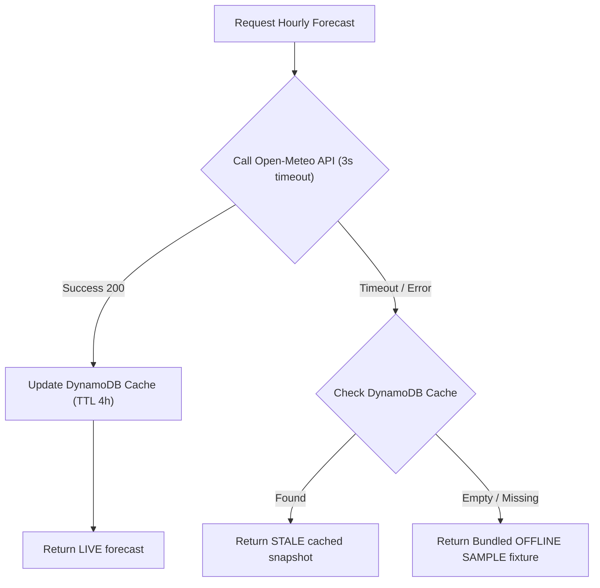

# ADR-003: Persistence and API Contract Design

- **Status**: Approved
- **Date**: 2026-10-09
- **Decision Owner**: Senior Java/AWS Architect & Ward Relief Engineer

## 1. Context and Problem Statement
HeatShield coordinators must assess wards, review 72-hour forecast heat indexes, and update action statuses (`PENDING`, `IN_PROGRESS`, `COMPLETED`).
Requirements:
1. Zero Personal Identifiable Information (PII) stored.
2. Zero idle operational cost.
3. Resilience against third-party API outages with cached forecasts (TTL).
4. Dual implementation: local testable in-memory repository vs. Amazon DynamoDB.

## 2. Decision

### Storage Choice: Amazon DynamoDB (On-Demand PAY_PER_REQUEST)
- Single-table design with Time-To-Live (TTL) enabled on forecast snapshots (4-hour cache).
- Primary Key Design:
  - `PK = WARD#<wardId>`
  - `SK = LATEST` (stores current snapshot) or `SK = ACTION#<actionId>` (stores state of prioritized action)
  - `SK = SNAPSHOT#<timestamp>` (historical logs, optional)

### Strict Privacy Guarantee (No PII)
The DynamoDB table definition and Java entities explicitly exclude names, phone numbers, exact residential coordinates, and medical notes. Attributes stored:
- `wardId` (e.g. `WARD_12_MARKET`)
- `temperatureC`, `humidityPct`, `computedHeatIndexC`, `riskTier`
- `actionId`, `status` (`PENDING`, `IN_PROGRESS`, `COMPLETED`), `updatedAt`
- `coordinatorRole` (e.g. `WARD_NODAL_OFFICER`, not personal identity)

### Resilience Architecture

### API Endpoints (Amazon API Gateway HTTP API v2)
1. `GET /api/health` -> System health & runtime diagnostic.
2. `POST /api/assessments` -> Evaluate manual what-if conditions: `{ wardId, temperatureC, humidityPct, imdDepartureC }`.
3. `GET /api/forecast?wardId=WARD_12` -> Ingest 72h Open-Meteo forecast, return peak window, computed hours-per-tier, and prioritized actions with deadlines.
4. `PATCH /api/actions/{actionId}` -> Update completion status: `{ status: "COMPLETED", note: "Water tankers positioned" }`.

### Repository Contract
- Interface: `heatshield.repository.AssessmentRepository`
- Implementations:
  - `InMemoryAssessmentRepository` (deterministic unit/integration tests without Docker).
  - `DynamoDbAssessmentRepository` (AWS SDK v2 with low-overhead HTTP client).
